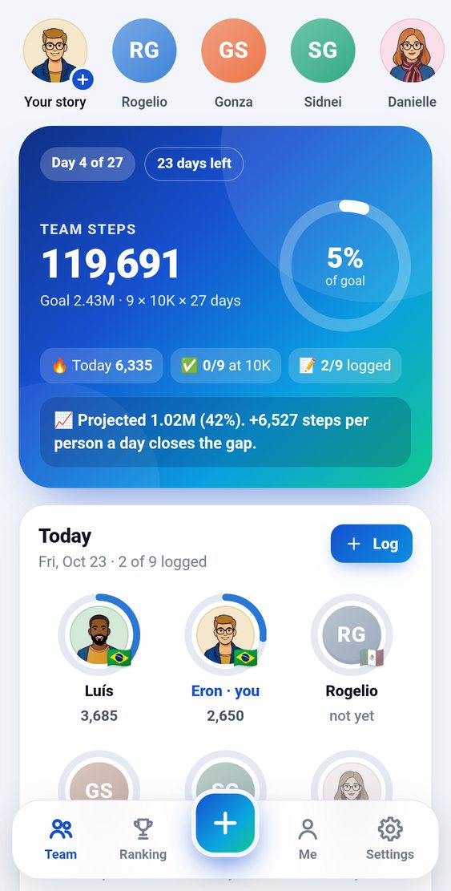
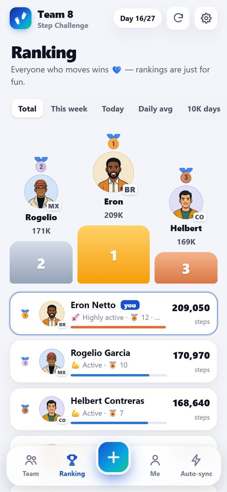
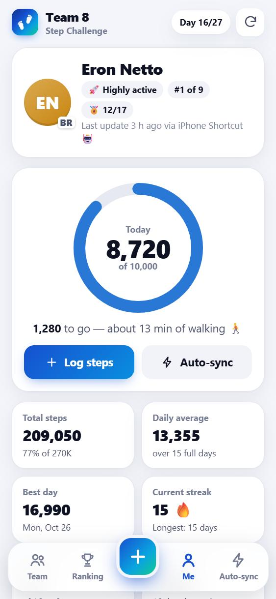
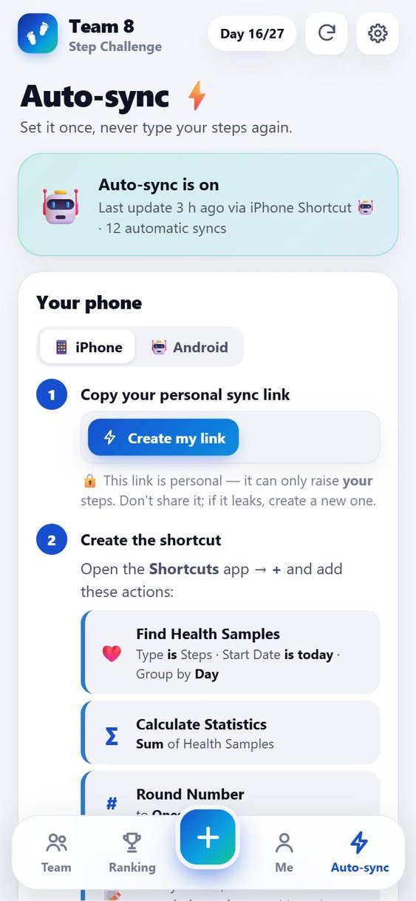

# 👟 Nokia - Step Challenge 2026 - Team 8

**Oct 20 – Nov 15, 2026 · 10,000 steps a day · 9 teammates 🇲🇽 🇺🇾 🇧🇷 🇨🇴**

A Progressive Web App (installable, works offline) for the Nokia Step Challenge 2026, Team 8. It has a live team dashboard,
automatic step sync from your phone, friendly rankings, badges, health insights and Instagram-style **stories**.

### ▶️ Open the app: **https://eronbfr.github.io/Step-Tracking-Challenge/**

| Team dashboard | Ranking | Me | Auto-sync |
|---|---|---|---|
|  |  |  |  |

## Install it like a native app

- **iPhone**: open the link in **Safari** → Share → **Add to Home Screen**
- **Android**: open the link in **Chrome** → ⋮ → **Install app**

On the home screen the app is called **Nokia Team 8**.

Then pick your language and your name (no password: your phone is your key), choose your avatar and turn on **Auto-sync**.

## Features

**Team dashboard**
- Team progress ring toward 2.43M steps, live “today” board with everyone's ring, goal-pace projection
- 🌎 **Team map** — real NASA satellite imagery on a 3D globe that unrolls into a map of Latin America, with
  everyone's avatar dropping onto their home city/state (today's progress ring, ✓ at 10K, tap for their card).
  Live day/night line with city lights on the night side, local time per city, animated arcs linking the cities,
  a pop-up “+steps” when someone logs, *World* mode (drag to spin the globe), zoom/pan, and a **country battle**
  (average steps per person) that flies the map to each country
- Daily team chart (with the 90K team goal line) and running total vs goal pace
- “Who walked when” heatmap (member × day) with 10K markers
- Team expedition: a marathon, then real distances between our home cities (Montevideo → Punta del Este, Bogotá → Medellín,
  Mexico City → Acapulco, Rio → São Paulo, Camino de Santiago, São Paulo → Montevideo, Bogotá → Mexico City)
- Fun facts: % around the Earth, CO₂ a car would emit, calories in tacos 🌮, arepas 🫓, empanadas 🥟, brigadeiros 🍫, alfajores 🍪

**Ranking**: Total, this week, today, daily average, 10K days, streak, plus a podium and Hall of Fame cards.

**📸 Stories** — everyone's avatar sits in the top bar; a colourful ring means there's something new to watch.
- Viewer like Instagram's: progress bars, tap left/right, hold to pause, swipe sideways (3D cube) to the next
  person, swipe down to close, reply or react (❤️ 🔥 👏 😂 😮 😍 💪 🎉). Your own story shows who saw it, the
  reactions and the replies; delete it any time (the captain can too). Stories last 24 h.
- Composer: in-app camera (tap = photo, hold = up to 15 s of video, front/back), gallery (longer videos are trimmed
  to 15 s), or an *Aa* text story on a gradient. Edit like on Instagram: 10 swipeable filters (WebGL), text in 6 styles with colours / highlight /
  alignment / size, stickers (today's steps, % of today's goal, streak, ranking, day of the challenge, your city,
  time, **@mentions**, TEAM 8, emoji), drawing (pen, marker, neon, eraser), and drag / pinch / rotate everything
  (snap guides, drag to the bin). Save to the phone or post; hitting 10K offers a ready-made story.
- Live: new stories, mentions, reactions and replies pop up in every open app within a second.

**Everywhere**
- ⚙️ **Settings** (*Ajustes*) in the bottom bar, laid out like the iPhone's: profile & devices, Auto-sync, refresh,
  daily reminder, install, language, appearance (light / dark / automatic), health profile & units, team captain,
  and *About & how we calculate*, whose **Source code** row opens this README inside the app. Pull down on any page
  to refresh.
- 🌐 Three languages — **English** (default), **Português (Brasil)** and **Español**. Picked on the first screen,
  changeable any time in ⚙️ Settings → Language. Numbers and dates follow the language (10,000 · 10.000).
- 🧑‍🎨 Avatar library — the 36 illustrated avatars of the Sintonia app (15 female, 21 male). The one you pick is
  shown to the whole team: today board, ranking, podium, heatmap, member cards, sign-in.
- ⚡ Live — when anyone logs steps, every open app updates within a second.

**Me**: today's ring, streaks, best day, consistency, projection, your daily steps vs the team average, weekday rhythm.
Also 17 badges and health metrics: distance, active calories, walking time, fat-energy, CO₂, BMI, WHO weekly activity,
Tudor-Locke activity level, and evidence cards (Lancet 2022, EJPC 2023, JAMA Neurology 2022, WHO 2020).
Details in [docs/METRICS.md](docs/METRICS.md).

## Automatic step updates

| Phone | How | Effort |
|---|---|---|
| **iPhone** | An Apple **Shortcuts** automation reads Apple Health and opens your personal sync link whenever you close an app you use daily (the iPhone is unlocked then, so Health is readable) | Set up once (~2 min), then fully automatic |
| **Android** | **Share a screenshot** of any health app (Samsung Health, Google Fit, Fitbit, Garmin…) to *Nokia Team 8*. The app reads the number with on-device OCR | 2 taps |
| Android power users | Tasker + the Tasker Health Connect plugin reads steps from Health Connect and calls the same sync link | Set up once (~10 min) |
| Everyone | Quick manual entry (+500 / +1K / +2.5K / +5K chips), backfill past days, works offline (queued), daily 9 PM calendar reminder | Seconds |

Automatic syncs never lower a day's value, so running them several times a day is safe. A sync of 0 (Health unreadable)
or without a number is ignored and flagged on the member's Auto-sync page. See [docs/IOS_SHORTCUT.md](docs/IOS_SHORTCUT.md).

## For the organizer

Nothing to deploy — the backend is this repository (details in **[docs/SETUP.md](docs/SETUP.md)**):

1. Open the app and **sign in as yourself first** — `eron` is the team captain (`ADMINS` in [`js/config.js`](js/config.js)),
   whose devices can approve sign-ins and reset anyone.
2. Share the message in [docs/ANNOUNCEMENT.md](docs/ANNOUNCEMENT.md) 🎉
3. The team spreadsheet [`step-tracking_Team8.xlsx`](step-tracking_Team8.xlsx) updates itself a few minutes after
   every change (also downloadable from ⚙️ Settings → Team captain).

`?demo` shows sample data; `?demo&asOf=2026-11-04` previews another day.

## Architecture

```
 PWA (GitHub Pages) ──signed message──▶ relay topic (ntfy.sh) ──live──▶ every open app
        ▲                                     │ every ~5 min
        │                                     ▼
        └──── data/data.json ◀── GitHub Action "Ledger": backend/fold.mjs + backend/sheet.py ──▶ step-tracking_Team8.xlsx
                                              backend/stories.mjs ──▶ branch `stories` (photos & videos, last 24 h)
```

- **Frontend**: vanilla JavaScript modules, no build step, hand-made SVG charts, system font, light/dark themes,
  service worker (offline shell, update prompt, Android share target), Web App Manifest with shortcuts.
- **Backend**: an event-sourced ledger ([`js/ledger.js`](js/ledger.js)) shared by the app and a scheduled GitHub
  Action. Each device signs its messages with its own ECDSA key (WebCrypto); public keys live in `data/data.json`.
  Device approval with a 4-digit code, captain reset, sync keys for the iPhone Shortcut, offline queue and resend.
- **Stories**: photos and videos travel as relay attachments (≤ 2 MiB each, so videos may come in parts); the
  Action copies them to the `stories` branch, rewritten as a single commit so expired media leaves no history.
- **Data**: `data/data.json` (snapshot), `data/log.csv` (every change) and the original Excel file, kept up to date.

```
index.html · manifest.webmanifest · sw.js · package.json
css/app.css
avatars/  36 WebP avatars (imported from Sintonia by tools/import_avatars.py)
assets/map/  NASA Blue Marble + Black Marble imagery and Natural Earth borders (built by tools/make_map.py)
js/  app.js (shell & flows) · views.js (pages) · settings.js (Settings) · markdown.js (README page) · charts.js (SVG) · metrics.js (health & stats) · ui.js · ocr.js · config.js
     stories.js (rail & viewer) · composer.js (camera & editor) · storykit.js (WebGL filters, text, stickers, export)
     api.js (snapshot + relay + outbox) · ledger.js (rules, shared with the Action) · device.js (signing key)
     i18n.js + strings.js (en / pt / es) · avatars.js (avatar library) · worldmap.js (WebGL team map)
data/  data.json · log.csv                    ← written by the Action
backend/  fold.mjs · stories.mjs · sheet.py · publish.sh · ledger.test.mjs
.github/workflows/ledger.yml
tools/  dev_server.py · mock_relay.py · import_avatars.py · make_icons.py · make_invites.py · make_map.py
docs/  SETUP.md · IOS_SHORTCUT.md · METRICS.md · ANNOUNCEMENT.md
```

## Development

```bash
python tools/dev_server.py 8765       # app (no-cache; service worker off on localhost, add ?sw to test it)
python tools/mock_relay.py 8766       # local relay → http://localhost:8765/?relay=http://localhost:8766
node --test backend/ledger.test.mjs   # ledger rules
python tools/make_icons.py            # regenerate icons
python tools/make_map.py <cache-dir>  # rebuild assets/map/ (downloads NASA + Natural Earth sources once)
```

When you release, bump `VERSION` in `sw.js` and `js/config.js` so installed apps pick up the new files. The Action commits to `main`
every few minutes while people log steps, so `git pull --rebase` before you push.

**This README is also the app's *Source code* page** (⚙️ Settings → About & how we calculate → Source code): the app
renders this very file, always the latest published version. Whenever the app changes, update this README in the same
commit — it is what the team reads in the app. Keep to plain Markdown (headings, lists, tables, code blocks, links,
images); links to repository files open on GitHub and images load from the app.

## Privacy

Names, avatars and daily step counts are visible to the team and stored in this public repository, together with the
team spreadsheet. Sign-in uses a key that never leaves your device. Height and weight entered in the app never
leave your phone.

Stories are public like everything else here: the photo or video sits on the public relay for 3 hours and on this
repository's `stories` branch while the story is on air (24 h). The branch is then rewritten without it — but anyone
who opened it could have saved a copy, so post what you'd show the whole team.

Each member's pin on the Team map is their city in `ROSTER` ([`js/config.js`](js/config.js)) — city level only.

Map imagery: NASA Visible Earth (Blue Marble Next Generation, Black Marble 2016) · borders: Natural Earth — both public domain.

---
*Health numbers are estimates, not medical advice.*
